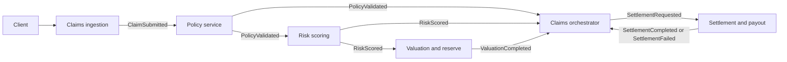

# Insurance Claims Processing & Settlement Platform

An event-driven reference application that demonstrates an insurance claim lifecycle across six independently deployable services. The workflow covers claim intake, policy validation, heuristic risk scoring, payout valuation, manual review, and settlement.

The services use RabbitMQ for event delivery, MongoDB for persistence, and Redis for idempotency and event deduplication. The settlement gateway is simulated: this project does not initiate real payments.

---

## Architecture and claim lifecycle



### Event Lifecycle & Transitions

1. **Claim submission:** The ingestion service validates and persists a claim, then publishes `ClaimSubmitted`.
2. **Policy validation:** The policy service checks policy status, coverage dates, claim type, and coverage limits. It publishes either `PolicyValidated` or `PolicyValidationFailed`.
3. **Risk scoring and valuation:** Risk scoring evaluates coverage utilization and attachment count. The valuation service applies the deductible and co-pay, then calculates the recommended reserve.
4. **Orchestration:** The orchestrator records lifecycle transitions. Eligible claims proceed to settlement; claims requiring review remain pending until an approval or rejection decision is recorded.
5. **Settlement:** The payout service records a simulated payout outcome and publishes `SettlementCompleted` or `SettlementFailed`. The orchestrator updates the final claim state.

---

## Services

| Service | Stack | Port | Responsibilities |
| --- | --- | --- | --- |
| `claims-ingestion-service` | Spring Boot / Java | `8081` | Validates and stores claims; publishes `ClaimSubmitted`. |
| `policy-service` | Spring Boot / Java | `8083` | Validates policy status, coverage dates, claim type, and limits. |
| `risk-scoring-service` | FastAPI / Python | `8084` | Calculates a rule-based risk score and review recommendation. |
| `valuation-reserve-service` | FastAPI / Python | `8085` | Calculates eligible payout and recommended reserve. |
| `claims-orchestrator` | Spring Boot / Java | `8082` | Tracks claim lifecycle, audit history, review decisions, and settlement dispatch. |
| `settlement-payout-service` | Spring Boot / Java | `8086` | Tracks payout state and audit history; uses a simulated payout gateway. |

## Reliability and traceability

- **Outbox publishing:** Services persist outbound events before scheduled publishers send them to RabbitMQ.
- **Duplicate handling:** Redis keys and persisted event records support idempotent request and event processing.
- **Dead-letter queues:** Unprocessed messages can be routed to configured dead-letter exchanges and queues.
- **Auditing and correlation:** Event envelopes carry correlation metadata, and claim and payout transitions are recorded in audit collections.

## Risk and valuation rules

The valuation service calculates:

1. `eligibleGross = min(claimedAmount, maxCoverageAmount)`
2. `basePayout = max(0, eligibleGross - deductibleAmount)`
3. `estimatedNetPayout = basePayout × (1 - coPayRatio)`

The recommended reserve applies a risk-tier multiplier to the net payout: `1.00` for LOW, `1.05` for MEDIUM, and `1.15` for HIGH risk.

Risk scoring starts at `15`, adds points for high or moderate coverage utilization and missing attachments, and caps the score at `100`. Scores below `40` are LOW, `40–74` are MEDIUM, and `75` or higher are HIGH. MEDIUM and HIGH scores require manual review. These rules are illustrative and are not insurance or financial advice.

## API overview

For request examples, import the [Postman collection](<docs/Insurance Claims.postman_collection.json>).

| Operation | Endpoint |
| --- | --- |
| Create or update a policy | `POST /api/v1/policies` |
| Submit a claim | `POST /api/v1/claims` |
| Get claim state | `GET /api/v1/claims/{claimId}` |
| Get claim audit history | `GET /api/v1/claims/{claimId}/audit` |
| Approve a claim | `POST /api/v1/claims/{claimId}/approve` |
| Reject a claim | `POST /api/v1/claims/{claimId}/reject` |
| Get risk score | `GET /api/v1/risk-scores/{claimId}` |
| Get valuation | `GET /api/v1/valuations/{claimId}` |
| Get payout status | `GET /api/v1/payouts/claims/{claimId}` |
| Get payout audit history | `GET /api/v1/payouts/claims/{claimId}/audit` |

## Local development

### Requirements

- Java 25
- Python 3.14
- MongoDB configured as a replica set, Redis, and RabbitMQ
- Docker, if you use containers to run infrastructure

See the setup guides for [Redis](docs/redis-setup.md) and [RabbitMQ](docs/rabbitmq-setup.md). Configure local service settings and provide credentials through local environment/configuration files; do not commit secrets.

### Run all services

Start the infrastructure above first. If the Python dependencies are not already installed, create the service environments and install them:

```bash
python3 -m venv risk-scoring-service/.venv
risk-scoring-service/.venv/bin/python -m pip install -r risk-scoring-service/requirements.txt

python3 -m venv valuation-reserve-service/.venv
valuation-reserve-service/.venv/bin/python -m pip install -r valuation-reserve-service/requirements.txt
```

From the repository root, run:

```bash
./scripts/run-local-services.sh
```

The script starts four Spring Boot services with Gradle and two FastAPI services with Uvicorn. It uses each service's `.venv` when available, or the interpreter specified by `PYTHON`. Press Ctrl+C to stop the services.

## Containers and CI

Each service has a Dockerfile. Build an image from the repository root with:

```bash
docker build -t claims-ingestion-service:local ./claims-ingestion-service
```

The [GitHub Actions workflow](.github/workflows/tests.yml) runs linting, unit tests and coverage, CodeQL, Python dependency audits, and the end-to-end claim lifecycle test. It builds container images on pull requests and publishes them to GitHub Container Registry (GHCR) after successful checks on `main`. Published images use `latest` and the full commit SHA tags, with names in this form:

```text
ghcr.io/amanfoundongithub/automated-insurance-claims-system-<service>
```

Provide MongoDB, Redis, RabbitMQ, and other required settings at runtime. Local `.env` and `application-local` files are excluded from the container build contexts. GHCR packages can be made public from their package settings if public access is desired.